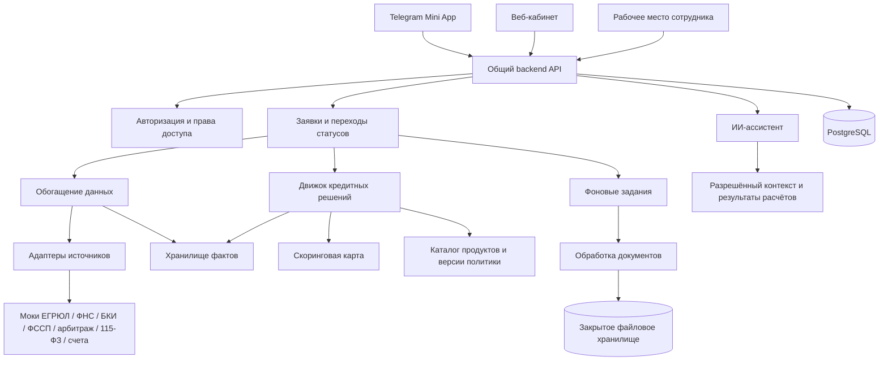

# Архитектура «Умного кредитного кабинета предпринимателя»

Документ описывает платформу: каналы, модули, данные, API и безопасность. **Кредитная логика, источники данных, статусы заявки и продукты описаны в [docs/v2/SPEC.md](docs/v2/SPEC.md)** — разделы v1 о скоринге, анкете и статусах удалены (они остались в истории git). Полная переработка этого документа под v2 — задача T35 в [docs/v2/TASKS.md](docs/v2/TASKS.md).

## 1. Что строим

Два клиентских продукта на одной платформе:

1. **Telegram Mini App** — пройти путь с телефона, получить предложение, подать заявку, прикрепить документы и отслеживать статус.
2. **Веб-сервис** — тот же путь, подробнее изучить расчёты, сравнить предложения, управлять заявками и документами.

Плюс рабочее место сотрудника банка (андеррайтер, риск-менеджер).

Telegram выбран как допущение: в исходном описании платформа mini app не названа. Для другой платформы меняется адаптер авторизации и интерфейс интеграции с оболочкой, кредитная логика остаётся общей.

Важно различать предварительный расчёт и решение по поданной заявке. Подбор продукта не означает одобрение кредита.

## 2. Общая схема

Для хакатона достаточно **модульного монолита**: один backend с чёткими внутренними модулями и отдельный процесс фонового обработчика из той же кодовой базы. Моки внешних источников — отдельный сервис, чтобы их можно было заменить реальными интеграциями без изменения движка.

Стек: TypeScript и React для клиентов, FastAPI/Python для backend и расчётов, PostgreSQL (локально — SQLite) для данных, S3-совместимое закрытое хранилище (локально — файлы на диске) для документов. Очередь заданий хранится в БД.

Два фронтенда используют общие компоненты, типы API и дизайн-систему, но имеют отдельные оболочки и маршруты. Сервер остаётся единственным источником правил, доступных переходов и расчётов.

## 3. Разница между каналами

| Возможность | Mini app | Веб-сервис |
|---|---|---|
| Начало работы | Вход через платформу | Вход в кабинет |
| Заявка | Короткие мобильные шаги | Те же шаги с обзором |
| Результат | Главное предложение и причины | Сравнение предложений и детализация расчёта |
| Документы | Загрузка с телефона | Загрузка и управление списком документов |
| Заявки | Статус и следующий шаг | История заявок, решений и изменений |
| ИИ-помощь | Контекстная подсказка | Подсказки и отдельная панель ассистента |

Пользователь должен иметь возможность завершить основной путь в любом из клиентов.

Для продолжения между каналами нужен единый внутренний `user_id`. Telegram-идентичность привязывается к существующему аккаунту только после подтверждения владения обоими входами. Совпадение имени или введённого телефона не является основанием для объединения аккаунтов.

## 4. Модули backend

| Модуль | Ответственность |
|---|---|
| Identity & Access | Вход, привязка каналов, принадлежность к бизнесу, роли |
| Business Profile | Карточка бизнеса, предзаполненная из источников |
| Need Intake | Короткий опрос о потребности и рекомендация продукта |
| Product Catalog | Ограничения продуктов, требования к обеспечению, версии политики |
| Sources & Enrichment | Адаптеры источников, параллельный опрос, тайм-ауты, повторы, политика отказа по источнику |
| Facts & Data Quality | Факты «заявлено / подтверждено» с источником и надёжностью; уровень качества данных по счёту |
| Features & Scoring | Расчёт признаков, скоринговая карта, версии модели |
| Decision Engine | Стоп-факторы, флаги, лимит, ставка, набор предложений, маршрутизация |
| Application Workflow | Подача заявки, версии параметров, допустимые переходы статусов |
| Documents | Запросы документов, загрузка, проверка |
| Underwriting | Очередь, досье, решения с кодом причины и комментарием, вторая подпись |
| AI Assistant | Объяснения и пересказ готовых расчётов |
| Audit & Notifications | История событий и уведомления без финансовых подробностей |

## 5. Роль ИИ

Кредитный движок работает детерминированно. ИИ не задаёт ставки и баллы, не меняет результат, не одобряет заявки и не запускает подачу без подтверждения пользователя.

Объяснение строится по структурированным данным: коды причин, ограничения суммы, условия, недостающие сведения и следующие шаги. У каждого кода есть готовый текст; если ИИ недоступен, пользователь всё равно получает полное объяснение по шаблону.

Подключение модели — только через OpenAI-совместимый API и переменные `LLM_BASE_URL`, `LLM_API_KEY`, `LLM_MODEL`; только модели с открытыми весами. Адаптер `apps/api/assistant.py` вызывает `{LLM_BASE_URL}/chat/completions`; без этих переменных или при ошибке модели помощник отвечает по шаблону.

В контекст ИИ передаётся только необходимая часть данных. Текст документов и внешних страниц рассматривается как источник сведений, а не как инструкции. Публичное объяснение отделено от внутренних причин решения; правила раскрытия задаются явно.

## 6. Модель данных

| Сущность | Основное содержание |
|---|---|
| User / AuthIdentity | Пользователь и связанные способы входа |
| Business / Membership | Бизнес, участники и их права |
| SourceCall | Источник, время, технический статус, сырой ответ |
| Fact | Заявленное и подтверждённое значение, источник, надёжность, время |
| ProductVersion / PolicyVersion / ModelVersion | Неизменяемые версии условий, порогов и скоринговой карты |
| Application / ApplicationRevision | Заявка и снимки её параметров |
| DecisionRun | Входной снимок, признаки, PD и грейд, вклады факторов, лимит и ставка по составляющим, маршрут |
| Offer | Условия предложения, срок актуальности и статус принятия |
| Document / DocumentRequest | Метаданные файла, назначение, проверка, запрос документов |
| UnderwritingReview | Решение сотрудника, код причины, комментарий, вторая подпись |
| AuditEvent / Job / Notification | История действий, фоновые работы и доставки |

Одному бизнесу соответствуют несколько заявок. У заявки несколько версий и запусков расчёта. Решение всегда ссылается на точные входные данные и версии политики и модели, чтобы его можно было воспроизвести. Форматы обмена между модулями — в [docs/v2/CONTRACTS.md](docs/v2/CONTRACTS.md).

## 7. Принципы API

Изменяющие запросы используют контроль версии записи; подача, принятие предложения и фоновые расчёты — ключи идемпотентности. Два открытых клиента не должны незаметно перезаписывать данные друг друга или создавать повторные заявки. Клиент получает явный конфликт версии и обновляет данные.

Состав методов v2 фиксируется в OpenAPI (задача T34).

## 8. Безопасность и эксплуатация

Сервер проверяет подлинность и свежесть данных входа mini app. Идентификатор пользователя, присланный клиентом без подтверждения платформы, не используется как доказательство входа. Для веба предусматриваются защищённые сессии и защита изменяющих запросов.

Каждый запрос проверяет доступ к конкретному бизнесу, заявке и документу. Роли: предприниматель, андеррайтер, риск-менеджер, администратор конфигурации. Изменения правил публикуют новую версию и не переписывают уже принятые решения.

Документы хранятся закрыто, выдаются через краткоживущие ссылки после проверки прав, ограничиваются по размеру и типу. Секреты, документы, ИНН и полные финансовые ответы не попадают в обычные логи. В уведомлении достаточно номера заявки и сообщения о смене статуса.

Для фоновых заданий нужны тайм-ауты, ограниченные повторы и защита от двойного выполнения. Переход статуса и запись события выполняются в одной транзакции. Контролируем время обработки, долю технических ошибок и застрявшие заявки.

В демонстрации используются синтетические данные. Перед реальной эксплуатацией отдельно проектируются политика хранения и удаления, основания обработки данных (152-ФЗ, банковская тайна), согласия на запрос кредитной истории (218-ФЗ) и требования банка — это не заменяется настройками хакатонного MVP.
