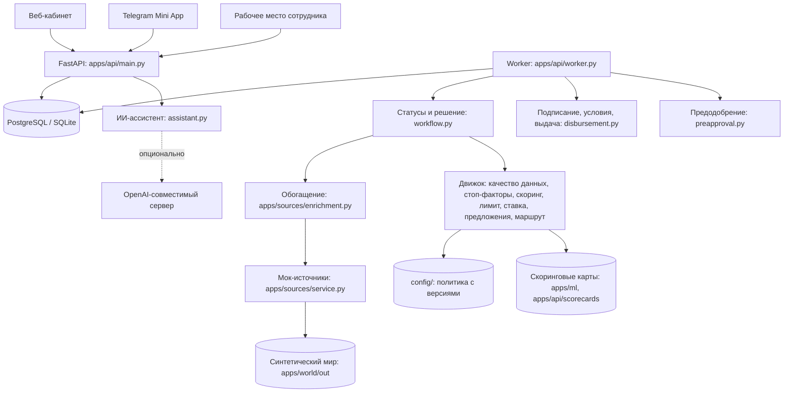
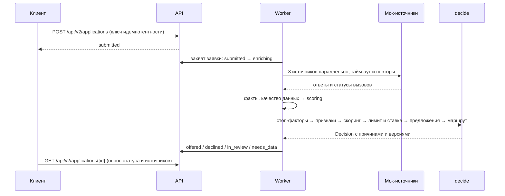

# Архитектура «Умного кредитного кабинета предпринимателя»

Платформа прототипа: каналы, модули, поток решения, данные, ИИ и безопасность. Кредитная логика и её обоснование — в [docs/v2/SPEC.md](docs/v2/SPEC.md), процесс и статусы — в [docs/PROCESS.md](docs/PROCESS.md), таблицы — в [docs/DATA_MODEL.md](docs/DATA_MODEL.md), форматы обмена между модулями — в [docs/v2/CONTRACTS.md](docs/v2/CONTRACTS.md).

## 1. Что построено

- **Кабинет клиента** — веб (`/`) и Telegram Mini App (`/mini/`): один React-клиент с двумя оболочками. Путь клиента: ИНН и согласия → потребность → анализ заявки → предложения → подписание → выдача; история заявок и предодобренный овердрафт.
- **Рабочее место сотрудника** (`/staff`): очередь заявок на рассмотрении, досье, действия с кодом причины, вторая подпись комитета, страница валидации модели для риск-менеджера.
- **Кредитный конвейер** — FastAPI-backend и worker из одной кодовой базы.
- **Синтетический мир и мок-источники** — данные, на которых работает конвейер и обучается модель.

Telegram выбран как допущение: в кейсе платформа mini app не названа. Для другой платформы меняется адаптер авторизации и оболочка, кредитная логика общая.

## 2. Общая схема

Это **модульный монолит**: один backend с чёткими модулями и worker, который в Docker работает отдельным контейнером, а локально — в процессе API. Внешние системы — моки за адаптерами (`apps/sources/`): их можно заменить настоящими интеграциями без изменения движка.

Стек: Python 3.12 и FastAPI для backend и расчётов, Pydantic для контрактов, SQLAlchemy и Alembic для данных, PostgreSQL в Docker и SQLite локально; React и TypeScript (Vite) для клиентов.

## 3. Модули

| Модуль | Где | Ответственность |
|---|---|---|
| Синтетический мир | `apps/world/` | Компании со скрытым качеством `q`, обороты по счёту, кредитные истории, мошеннические архетипы, клиенты с неполными данными, исходы дефолта; демо-персоны ([README](apps/world/README.md), [PERSONAS.md](apps/world/PERSONAS.md)) |
| Источники и обогащение | `apps/sources/` | Мок-сервис восьми источников с задержками и сбоями; адаптеры, параллельный опрос, тайм-ауты, повторы, политика отказа по источнику; факты «заявлено / подтверждено» ([README](apps/sources/README.md)) |
| Признаки и качество данных | `apps/api/features/` | Одна библиотека признаков для обучения и движка; уровень качества данных `FULL` / `PARTIAL` / `THIN` ([README](apps/api/features/README.md)) |
| Обучение модели | `apps/ml/` | WoE-разбиение, логистическая регрессия, перевод в баллы, выгрузка `scorecard_v1.json`; валидация: Gini, калибровка, PSI ([README](apps/ml/README.md)) |
| Хранилище фактов | `apps/api/fact_store.py` | Факты заявки с источником, уровнем надёжности и временем |
| Стоп-факторы и флаги | `apps/api/stop_factors.py` | Автоматический отказ и поводы для ручного рассмотрения ([STOP_FACTORS.md](apps/api/STOP_FACTORS.md)) |
| Скоринг | `apps/api/scoring.py` | Применение карты, PD и грейд, вклады признаков; претендент в теневом режиме ([SCORING.md](apps/api/SCORING.md)) |
| Лимит и ставка | `apps/api/limits.py`, `pricing.py`, `credit_policy.py` | Лимит — минимум из ограничений; ставка по составляющим; политика из `config/credit_policy.json` ([LIMITS.md](apps/api/LIMITS.md)) |
| Предложения | `apps/api/offers.py` | До трёх вариантов и контрфактические подсказки ([OFFERS.md](apps/api/OFFERS.md)) |
| Маршрутизация | `apps/api/routing.py` | Матрица полномочий с причинами ([ROUTING.md](apps/api/ROUTING.md)) |
| Статусы и журнал | `apps/api/workflow.py`, `worker.py` | Таблица переходов, журнал событий, очередь worker, решение `decide` ([WORKFLOW.md](apps/api/WORKFLOW.md)) |
| Действия сотрудников | `apps/api/staff_actions.py` | Одобрить, изменить, отказать, запросить данные, перезапустить; комитет — две подписи ([STAFF_ACTIONS.md](apps/api/STAFF_ACTIONS.md)) |
| Выписки | `apps/api/statements.py` | Загрузка выписки из другого банка и пересчёт ([STATEMENTS.md](apps/api/STATEMENTS.md)) |
| Подписание и выдача | `apps/api/disbursement.py` | Документы, код подписания, отлагательные условия, выдача ([DISBURSEMENT.md](apps/api/DISBURSEMENT.md)) |
| Предодобрение | `apps/api/preapproval.py` | Ежедневный пакет овердрафтов для клиентов `FULL` ([PREAPPROVAL.md](apps/api/PREAPPROVAL.md)) |
| Демо-доступ | `apps/api/demo_companies.py`, `main.py` | Демо-профили, каталог компаний, вход сотрудника с выбором должности |
| ИИ-ассистент | `apps/api/assistant.py` | Ответы по шаблону, опционально — через модель |
| Клиент и рабочее место | `apps/web/src/` | Экраны клиента и сотрудника ([apps/web/README.md](apps/web/README.md)) |
| Контракты | `apps/api/contracts.py`, `tests/fixtures/` | Pydantic-модели между треками и примеры ([CONTRACTS.md](docs/v2/CONTRACTS.md)) |

## 4. Как принимается решение

`decide` — чистая функция: на одних и тех же ответах источников, картах и версиях политики она даёт одно и то же решение. Стоп-факторы, признаки и балл считаются только по нашим данным и госисточникам; выписка клиента влияет на качество данных и лимит, но не на балл. Порядок вызовов и все исходы — [WORKFLOW.md](apps/api/WORKFLOW.md).

Пороги — кредитная политика в `config/` с версиями (`features`, `data_quality`, `credit_policy`, `world_outcomes`); значения подтверждает экономический блок. Часть порогов пока константы в коде, они перечислены в [docs/SIMPLIFICATIONS.md](docs/SIMPLIFICATIONS.md).

## 5. Каналы

| Возможность | Mini app | Веб-кабинет |
|---|---|---|
| Вход | Через Telegram (проверка `initData`) или демо-вход | Демо-вход |
| Заявка | Те же шаги в мобильной вёрстке | Те же шаги |
| Анализ и решение | Общий экран анализа | Общий экран анализа |
| Заявки | История заявок и выдач | История заявок и выдач |

Оба канала — одна сборка React с общими компонентами; сервер — единственный источник правил, переходов и расчётов. Telegram-идентичность привязывается к аккаунту только после подтверждения владения обоими входами (одноразовый код); совпадение имени или телефона не объединяет аккаунты.

## 6. Роль ИИ

Кредитный движок работает детерминированно. ИИ не задаёт ставки и баллы, не меняет результат, не одобряет заявки и не запускает действия.

Подключение модели — только через OpenAI-совместимый API и переменные `LLM_BASE_URL`, `LLM_API_KEY`, `LLM_MODEL`; только модели с открытыми весами. Адаптер вызывает `{LLM_BASE_URL}/chat/completions`; без этих переменных или при ошибке модели помощник отвечает по шаблону, и сценарий работает так же. В контекст модели передаётся минимум: вопрос и справочный текст, без реквизитов, файлов и финансового профиля; ответ с числами, которых нет в контексте, отклоняется. Подробно — README, раздел «Языковая модель».

Объяснения клиенту и сотруднику строятся без модели: у каждой причины решения, флага и ограничения лимита есть код и готовый текст, отдельно для клиента и для сотрудника.

## 7. API

Методы — в OpenAPI: http://127.0.0.1:8000/docs и [docs/api/openapi.json](docs/api/openapi.json); сквозной сценарий — [docs/api/requests.http](docs/api/requests.http). Методы v2 — под `/api/v2`, вход — под `/api/auth`.

Изменяющие запросы клиента передают версию строки заявки (`revision`): устаревшая версия даёт 409, поэтому два открытых окна не перезаписывают друг друга. Подача заявки идемпотентна по ключу: повтор возвращает ту же заявку.

## 8. Безопасность и эксплуатация

- **Сессии.** Cookie-сессии, проверка `Origin` у изменяющих запросов, `COOKIE_SECURE` за HTTPS. Данные входа mini app проверяются по HMAC и возрасту (до 5 минут); идентификатор, присланный клиентом без подписи платформы, не принимается.
- **Доступ.** Клиент видит только свои заявки и сокращённое решение без флагов, баллов и PD (среди флагов есть признаки ПОД/ФТ); сотрудник видит всё. Вторая подпись комитета — только сотрудник с другой должностью.
- **Журнал.** Переход статуса и запись события — в одной транзакции; журнал только дополняется. Изменение политики — новая версия в `config/`, уже принятые решения не пересчитываются.
- **Секреты.** Только через `.env`, в репозитории — `.env.example` со всеми переменными. Код подписания хранится хэшем.
- **Устойчивость.** Тайм-ауты и повторы по источникам, аренда заявки worker, повтор расчёта после сбоя — [docs/SLA.md](docs/SLA.md).

Прототип работает только на синтетических данных. Перед реальной эксплуатацией отдельно проектируются политика хранения и удаления, основания обработки данных (152-ФЗ, банковская тайна), реестр согласий на запрос кредитной истории (218-ФЗ) и требования банка.
