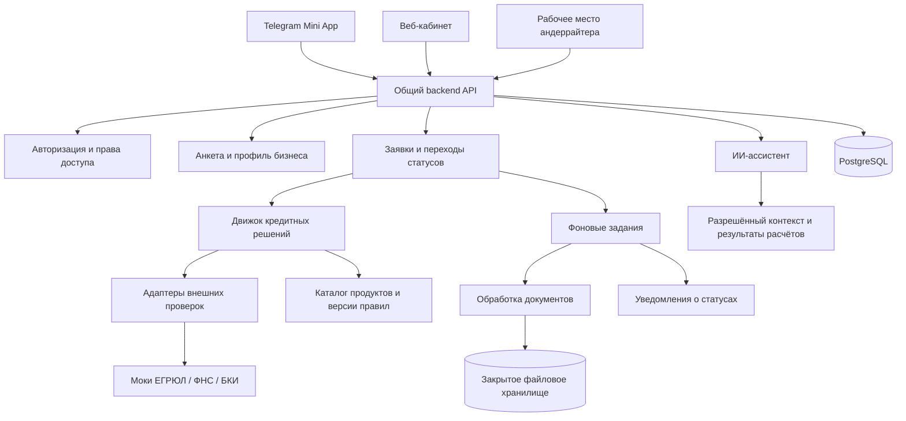
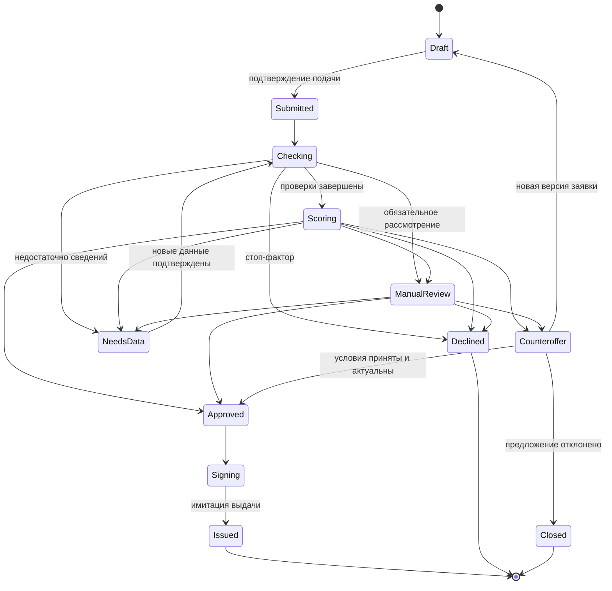

# Архитектура «Умного кредитного кабинета предпринимателя»

Документ подготовлен по файлу «скретчпад хакатон альфа.txt». Это проект архитектуры, без реализации. Все кредитные продукты, ставки, пороги и решения в MVP — синтетические, для демонстрации кейса.

## 1. Что строим

Два клиентских продукта на одной платформе:

1. **Telegram Mini App** — пройти адаптивный опрос с телефона, получить предварительный подбор, подать заявку, прикрепить документы и отслеживать статус.
2. **Веб-сервис** — пройти тот же опрос, подробнее изучить расчёты, сравнить предложения, управлять заявками и документами.

Telegram выбран как допущение: в исходном описании платформа mini app не названа. Для другой платформы меняется адаптер авторизации и интерфейс интеграции с оболочкой, кредитная логика остаётся общей.

Скриншот задаёт принцип интерфейса: один основной вопрос на экране, крупные варианты ответа, кнопка назад и прогресс по разделам. Тематика вопросов — бизнес и финансирование. Медицинские вопросы со скриншота не используются.

Основной сценарий: **потребность бизнеса → адаптивная анкета → подбор продукта → подтверждение заявки → проверки → решение → принятие условий → имитация подписания и выдачи**.

Важно различать предварительную рекомендацию по ответам и решение по поданной заявке. Подбор продукта не означает одобрение кредита.

## 2. Границы MVP

В MVP входят три продукта из исходного файла:

| Продукт | Сумма или лимит | Срок | Особенность |
|---|---|---|---|
| Оборотный кредит | 100 тыс. – 5 млн ₽ | 3–12 месяцев | Финансирование текущей деятельности |
| Инвестиционный кредит | 500 тыс. – 15 млн ₽ | 12–60 месяцев | Оборудование и обязательная проверка залога |
| Кредитная линия | 300 тыс. – 10 млн ₽ | До 12 месяцев | Лимит и использование средств частями |

Минимальный срок кредитной линии и правила частичного залога нужно явно задать в демонстрационном каталоге до реализации. Это открытые параметры, а не подразумеваемые банковские условия.

Внешние проверки ЕГРЮЛ/ЕГРИП, ФНС и БКИ работают через воспроизводимые моки. Подписание и выдача также имитируются. Реальные банковские интеграции, юридически значимое подписание, переводы денег и ML-скоринг находятся за пределами MVP.

Идею «вот моя кофейня, сколько вложить, чтобы окупилось» разделяем на два слоя: подбор финансирования входит в MVP; прогноз роста прибыли и окупаемости — отдельный будущий модуль сценарного анализа. Из ссылки на бизнес нельзя достоверно получить его выручку, расходы и ожидаемую доходность.

## 3. Общая схема



Для хакатона достаточно **модульного монолита**: один backend с чёткими внутренними модулями и отдельный процесс фонового обработчика из той же кодовой базы. Микросервисы и отдельный сетевой сервис для скоринга пока не нужны.

Предлагаемый стек: TypeScript и React для клиентов, FastAPI/Python для backend и расчётов, PostgreSQL для данных, S3-совместимое закрытое хранилище для документов. Для MVP очередь заданий может храниться в PostgreSQL; отдельный брокер добавляется при необходимости. Версии библиотек выбираются на этапе реализации.

Два фронтенда используют общие компоненты вопросов, типы API и дизайн-систему, но имеют отдельные оболочки и маршруты. Сервер остаётся единственным источником правил, доступных переходов и расчётов.

## 4. Разница между продуктами

| Возможность | Mini app | Веб-сервис |
|---|---|---|
| Начало работы | Вход через платформу | Вход в кабинет |
| Опрос | Короткие мобильные шаги | Те же шаги с обзором разделов |
| Возврат к анкете | Продолжение сохранённого черновика | Продолжение того же черновика |
| Результат | Главное предложение и причины | Сравнение продуктов и детализация расчёта |
| Документы | Загрузка с телефона | Загрузка и управление списком документов |
| Заявки | Статус и следующий шаг | История заявок, решений и изменений |
| ИИ-помощь | Контекстная подсказка к вопросу | Подсказки и отдельная панель ассистента |

Пользователь должен иметь возможность завершить основной путь в любом из клиентов. Переход в веб — удобство, а не обязательное условие.

Для продолжения между каналами нужен единый внутренний `user_id`. Telegram-идентичность привязывается к существующему аккаунту только после подтверждения владения обоими входами. Совпадение имени или введённого телефона не является основанием для объединения аккаунтов.

## 5. Архитектура опросника

Анкета — версионируемый сценарий, а не зашитая последовательность экранов. Каждый вопрос содержит идентификатор, раздел, тип ответа, ограничения, условие показа, обязательность, пояснение и соответствие полю профиля или заявки.

Типы вопросов: один вариант, несколько вариантов, денежная сумма, число, дата, шкала, короткий текст, таблица месячных показателей, файл. «Не знаю» и «Нет данных» хранятся отдельно от нулевого значения. Значения проходят серверную проверку.

Ориентир по объёму — 35–45 вопросов в каталоге, из которых конкретному пользователю показываются примерно 20–30. Длина зависит от цели, продукта и уже известных данных. Обширность достигается уточняющими ветками, а не обязательным прохождением всей анкеты.

| Раздел | Примеры вопросов | Как используется |
|---|---|---|
| Потребность | На что нужны деньги? Какую задачу хотите решить? Когда нужны средства? Разовая покупка или регулярная потребность? | Выбор ветки и подходящих продуктов |
| Бизнес | ИНН? ИП или ООО? Дата регистрации? Основная деятельность? Регион? Сколько точек? | Профиль, срок бизнеса, отраслевые проверки |
| Финансы | Выручка за последние 12 месяцев? Как она менялась по месяцам? Есть сезонность? Каковы регулярные расходы? | Динамика выручки, оценка полноты данных, расчёт нагрузки |
| Обязательства | Остаток действующих кредитов? Ежемесячные платежи? Есть просрочки? Какова их длительность и давность? | Раздельный расчёт долга и платежной нагрузки |
| Запрос | Какая сумма нужна? Какой срок удобен? Какой платёж приемлем? Можно ли уменьшить сумму или увеличить срок? | Проверка параметров и контрпредложения |
| Оборудование | Что покупаете? Стоимость? Первоначальный взнос? Есть счёт поставщика? Какой залог доступен? | Инвестиционная ветка и документы |
| Кредитная линия | Когда возникают кассовые разрывы? Какой максимальный дефицит? Когда приходят деньги? Какую часть лимита ожидаете использовать? | Расчёт лимита и сценария обслуживания линии |
| Подтверждение | Верны ли сведения? Какие документы готовы предоставить? | Проверка перед подачей и сбор документов |

Формулировки должны быть понятными: «Сколько вы ежемесячно платите по действующим кредитам?» вместо требования самостоятельно рассчитать коэффициент долговой нагрузки.

Примеры ветвления:

- «Купить оборудование» → вопросы о поставщике, стоимости и залоге.
- «Покрыть кассовые разрывы» → вопросы о сроках поступления денег и использовании лимита.
- «Есть кредиты» → остаток долга и платежи; при ответе «нет» соответствующая ветка пропускается.
- «Есть сезонность» → месячная выручка вместо одного среднего значения.
- «Не знаю сумму» → уточнение стоимости потребности; сумма не придумывается ассистентом.

Ответ сохраняется после каждого шага. При возвращении назад и изменении ответа сервер пересчитывает активные ветки: скрытые ответы исключаются из расчётов, а их история сохраняется для аудита. Уже выданная рекомендация становится устаревшей до пересчёта.

Прогресс показывается по разделам и текущему активному маршруту: нельзя обещать фиксированное число вопросов, если дальнейшие ответы раскрывают новые ветки. Перед подачей пользователь видит сводку и исправляет данные.

## 6. Модули backend

| Модуль | Ответственность |
|---|---|
| Identity & Access | Вход, привязка каналов, принадлежность к бизнесу, роли |
| Business Profile | Реквизиты и финансовые данные с источником и датой актуальности |
| Questionnaire | Версии анкет, ответы, ветвления, прогресс и полнота |
| Product Catalog | Ограничения продуктов, условные ставки, требования к залогу |
| Recommendation | Соответствие потребности продукту и предварительное сравнение |
| Application Workflow | Подача заявки, версии параметров, допустимые переходы статусов |
| External Checks | Нормализация результатов моков и будущих интеграций |
| Decision Engine | Стоп-факторы, баллы риска, расчёт суммы, матрица исходов |
| Documents | Запросы документов, загрузка, проверка и подтверждение извлечённых данных |
| Underwriting | Очередь ручного рассмотрения и решение с комментарием |
| AI Assistant | Объяснение вопросов, сбор намерения и пересказ готовых расчётов |
| Audit & Notifications | История событий и уведомления без финансовых подробностей |

## 7. Единый алгоритм решения

1. **Проверить полноту данных.** Отсутствующая выручка или ошибка интеграции не равны нулевой выручке или плохой кредитной истории. При недостатке данных запускается уточнение либо повтор проверки.
2. **Зафиксировать снимок заявки.** Параметры, ответы, источники данных, версия каталога и правил становятся входом конкретного запуска расчёта.
3. **Выполнить внешние проверки.** Сохранить результат каждой проверки, её время и технический статус отдельно от бизнес-результата.
4. **Проверить стоп-факторы.** Отсутствие или недействующий статус бизнеса, запретная отрасль, значимая текущая просрочка, эпизод 90+ дней в установленном окне, долг более 80% годовой выручки — демонстрационные причины отказа. При срабатывании скоринг не запускается.
5. **Проверить маршрутизацию.** Отрасль ручного рассмотрения или несоответствие деятельности цели направляет заявку андеррайтеру. Параметры вне продуктового диапазона запускают поиск допустимого предложения.
6. **Рассчитать риск.** Вернуть сумму баллов, вклад факторов и категорию риска.
7. **Рассчитать ограничения суммы или лимита.** Проверить платежеспособность, потолок относительно выручки, продуктовые ограничения и требования к обеспечению.
8. **Выбрать исход.** Одобрение, контрпредложение, запрос данных, ручное рассмотрение или отказ.
9. **Сформировать объяснение.** Показать причины, условия и доступное следующее действие.

Порядок приоритетов: стоп-фактор → обязательная ручная проверка → достаточность данных для автоматического решения → риск и количественные ограничения. Если часть проверок технически не завершилась, автоматическое одобрение не допускается.

### Единая шкала риска

Используем подробную шкалу из финальной части TXT: до 30 включительно — низкий, больше 30 и до 60 — средний, больше 60 и до 90 — высокий, больше 90 — очень высокий. Так интервалы покрывают и дробные баллы после уменьшения веса старых просрочек. Отрицательный итог из-за бонусов также относится к низкому риску.

Все веса должны быть вынесены в конфигурацию. В TXT не заданы точные баллы для возраста бизнеса, динамики выручки, диапазонов долга и некоторых других факторов; их нельзя считать готовой спецификацией. Перед реализацией нужен полный демонстрационный справочник весов и граничных условий.

Предлагаемые уточнения спорных правил:

- Для несущественных просрочек сначала применяется единый фильтр суммы: меньше 1 000 ₽ **или** меньше 1% соответствующего платежа. Его применимость к стоп-факторам должна быть явно задана в правилах; для MVP предлагается исключать такие эпизоды из обоих расчётов.
- После фильтра текущая просрочка и эпизод длительностью **90 дней и более** за последние 36 месяцев имеют приоритет над начислением баллов. Интервал +40 баллов относится к 61–89 дням.
- Три значимых эпизода за последние 12 месяцев задают минимум «высокий риск», а не случайный выбор между высоким риском и отказом.
- Для нулевой или отсутствующей годовой выручки деление не выполняется: автоматический расчёт останавливается и требуется отдельное рассмотрение.

### Расчёт суммы для обычного кредита

Обозначения: `R` — годовая выручка, `D` — действующие ежемесячные платежи, `r` — месячная ставка, `n` — срок в месяцах.

Допустимый новый ежемесячный платёж по синтетическому правилу TXT:

`P = max(0, 0.35 × R / 12 − D)`.

Максимальная сумма по этому платежу при аннуитете:

`A_payment = P × (1 − (1 + r)^(-n)) / r`.

При нулевой ставке используется `A_payment = P × n`. Ставка берётся из версии каталога; комиссии и дополнительные платежи, если они появятся, должны учитываться отдельно. Суммы хранятся и округляются по единому денежному правилу.

Для оборотного кредита:

`A = min(запрос × коэффициент риска, A_payment, 0.50 × R, максимум продукта)`.

Для оборудования потолок по выручке — `0.70 × R`, дополнительно применяется предел по приемлемой стоимости залога и коэффициенту покрытия из каталога. Недостающие документы по залогу ведут к запросу данных, отсутствие подходящего залога — к пересмотру предложения.

Коэффициенты из TXT: низкий риск — 1.0, средний — 0.7, высокий — 0.5 только для сценария ручного решения после дополнительных данных; очень высокий — отказ. Рассчитанная сумма при высоком риске не показывается как автоматически одобренная.

### Отдельная модель кредитной линии

Для линии нельзя без пояснений использовать аннуитет всей суммы: лимит и фактическая задолженность различаются. Нужен отдельный калькулятор с версионируемой моделью выборки и погашения.

Для MVP предлагается консервативный сценарий: полная выборка лимита, ежемесячные проценты на остаток и равномерное погашение основного долга за срок линии. Проверяется максимальный месячный платёж; дополнительно показывается сценарий ожидаемого использования, введённый клиентом. Это демонстрационная модель, не описание банковского тарифа.

Лимит ограничивается коэффициентом риска, платежной нагрузкой выбранной модели, 50% годовой выручки и максимумом продукта. Вид погашения, доступность повторной выборки и требования к обеспечению явно хранятся в каталоге.

### Матрица исходов

| Условие | Исход |
|---|---|
| Низкий риск, все ограничения соблюдены | Одобрение запрошенных условий |
| Низкий риск, допустимая сумма меньше запрошенной | Контрпредложение |
| Средний риск | Контрпредложение с пересчитанными условиями; для оборудования также проверка залога |
| Высокий риск, документы ещё не запрашивались | Запрос дополнительных данных |
| Высокий риск сохранился после проверки документов | Ручное рассмотрение |
| Очень высокий риск | Отказ |
| Сумма ниже минимума | Поиск среди трёх продуктов MVP; при отсутствии подходящего — отказ |

Увеличение срока создаёт новый вариант расчёта и помогает только против ограничения по платежу. Оно не отменяет ограничение по коэффициенту риска или потолок выручки. Залог также не отменяет остальные ограничения.

Переключение продукта не происходит молча: клиент получает альтернативу и подтверждает изменённые цель, сумму и срок. Повторный подбор не должен образовывать цикл; кандидаты оцениваются конечным списком из трёх продуктов.

## 8. Состояния заявки



Технический сбой проверки отражается в статусе задания и интерфейсе ожидания, а не переводит заявку в отказ. Повторы ограничены; после их исчерпания задача уходит оператору.

После загрузки файлов сначала проверяется их содержимое и подтверждаются новые данные. Сам факт загрузки не снижает риск. Повторное решение получает новую версию; предыдущая остаётся в истории. Просроченное предложение требует пересчёта перед принятием.

## 9. Роль ИИ

ИИ помогает понять вопрос, переводит свободное описание потребности в предложенные поля анкеты, объясняет подтверждённые результаты и составляет список необходимых документов. Извлечённые значения пользователь подтверждает перед использованием.

Кредитный движок работает детерминированно. ИИ не задаёт ставки и баллы, не меняет результат, не одобряет заявки и не запускает подачу без подтверждения пользователя.

Объяснение строится по структурированным данным: `reason_codes`, ограничения суммы, условия, недостающие сведения и следующие шаги. У каждого кода есть готовый текст; если ИИ недоступен, пользователь всё равно получает полное объяснение по шаблону.

В контекст ИИ передаётся только необходимая часть данных. Текст документов и внешних страниц рассматривается как источник сведений, а не как инструкции. Публичное объяснение отделено от внутренних причин решения; правила раскрытия задаются явно.

## 10. Модель данных

| Сущность | Основное содержание |
|---|---|
| User / AuthIdentity | Пользователь и связанные способы входа |
| Business / Membership | Бизнес, участники и их права |
| FinancialSnapshot | Выручка, долг, платежи, период, источник, подтверждение |
| QuestionnaireVersion / SurveySession / Answer | Сценарий, прохождение, активные ответы и история |
| ProductVersion / RuleSetVersion | Неизменяемые версии условий, весов и порогов |
| Application / ApplicationRevision | Заявка и снимки её параметров |
| CheckRun | Тип проверки, источник, время, результат, техническая ошибка |
| DecisionRun | Входной снимок, баллы, вклад факторов, ограничения, исход |
| Offer | Условия предложения, срок актуальности и статус принятия |
| Document / DocumentRequest | Метаданные файла, назначение, проверка, запрос документов |
| UnderwritingReview | Решение сотрудника, основание, комментарий |
| AuditEvent / Job / Notification | История действий, фоновые работы и доставки |

Одному бизнесу соответствуют несколько заявок. У заявки несколько версий и запусков расчёта. Решение всегда ссылается на точные входные данные и версии правил, чтобы его можно было воспроизвести.

## 11. Контракты API

Предлагаемые группы методов:

- `/auth/*` — вход, подтверждение и привязка каналов.
- `/businesses/*` — доступные бизнесы и их профили.
- `/surveys` — создание прохождения; `/surveys/{id}/answers` — сохранение ответов; `/surveys/{id}/next` — следующий активный вопрос.
- `/recommendations` — предварительный подбор по версии анкеты.
- `/applications` — создание заявки; `/applications/{id}/submit` — явная подача.
- `/applications/{id}` и `/applications/{id}/timeline` — состояние и история.
- `/applications/{id}/offers` — условия и причины; отдельные действия принятия и отклонения предложения.
- `/applications/{id}/documents` — запрос безопасной загрузки и подтверждение её завершения.
- `/assistant/messages` — контекстные вопросы пользователя.
- `/staff/reviews/*` — рабочая очередь и решения андеррайтера.

Изменяющие запросы используют контроль версии записи; подача, принятие предложения и фоновые расчёты — ключи идемпотентности. Два открытых клиента не должны незаметно перезаписывать ответы друг друга или создавать повторные заявки. Клиент получает явный конфликт версии и обновляет данные.

## 12. Безопасность и эксплуатация

Сервер проверяет подлинность и свежесть данных входа mini app. Идентификатор пользователя, присланный клиентом без подтверждения платформы, не используется как доказательство входа. Для веба предусматриваются защищённые сессии и защита изменяющих запросов.

Каждый запрос проверяет доступ к конкретному бизнесу, заявке и документу. Роли: предприниматель, андеррайтер, администратор конфигурации. Изменения правил публикуют новую версию и не переписывают уже принятые решения.

Документы хранятся закрыто, выдаются через краткоживущие ссылки после проверки прав, ограничиваются по размеру и типу. Секреты, документы, ИНН и полные финансовые ответы не попадают в обычные логи. В уведомлении достаточно номера заявки и сообщения о смене статуса.

Для фоновых заданий нужны тайм-ауты, ограниченные повторы и защита от двойного выполнения. Переход статуса и запись события выполняются в одной транзакции; доставка уведомлений запускается через сохранённое событие. Контролируем время обработки, долю технических ошибок, застрявшие заявки и отказы на шагах анкеты.

В демонстрации используются синтетические данные. Перед реальной эксплуатацией отдельно проектируются политика хранения и удаления, основания обработки данных, договоры интеграций и требования банка — это не заменяется настройками хакатонного MVP.

## 13. Структура проекта и запуск

```text
alfa_hack/
  apps/
    web/                  веб-кабинет и защищённые маршруты сотрудников
    mini/                 мобильная оболочка и адаптер Telegram
    api/                  backend с модулями предметной области
    worker/               запуск фоновых задач из общей backend-кодовой базы
  packages/
    ui/                   общие компоненты и дизайн-система
    api-client/           типизированный клиент по OpenAPI
    questionnaire-schema/ общая схема описания вопросов
  config/
    products/             версии демонстрационных продуктов
    rules/                веса, пороги, матрицы и причины
    questionnaires/       версии анкеты
  fixtures/               тестовые бизнесы и ответы внешних моков
  docs/                   схема API, сценарии демонстрации, допущения
  infra/                  локальная конфигурация запуска
```

Это предлагаемая структура, каталоги и приложения не созданы. Локальный запуск в будущем объединяет фронтенды, API, worker, PostgreSQL и хранилище. Для проверки mini app внутри Telegram понадобится доступный HTTPS-адрес.

## 14. Порядок реализации и критерии готовности

1. **Зафиксировать правила:** заполнить недостающие веса, ставки, требования к залогу, модель линии, сроки актуальности данных и предложений. Проверить противоречия на числовых примерах.
2. **Собрать общее ядро:** каталог, анкета, версии данных, расчёты, моки и состояния заявки.
3. **Создать веб-опросник:** ветвление, автосохранение, сводка, подача и результаты.
4. **Создать mini app:** общие компоненты, вход через платформу, мобильные сценарии, продолжение анкеты между каналами.
5. **Добавить документы и ручное рассмотрение:** запрос, проверка, повторный расчёт, комментарий сотрудника.
6. **Подключить ИИ и завершить демо:** подсказки, объяснения, шаблонный режим при недоступности модели, имитация подписания и выдачи.

Критерии проверки:

- Семь персон из TXT воспроизводят заданные исходы: одобрение, снижение суммы, оборудование с залогом, снижение риска после новых данных, ручное рассмотрение, альтернативный продукт и стоп-фактор.
- Низкий риск не обходит ограничения по платежу и сумме.
- Границы 30/60/90 баллов, 80% долга, 90 дней просрочки и сроков давности трактуются однозначно.
- Недоступность БКИ не превращается в отказ или автоматическое одобрение.
- Изменение раннего ответа исключает неактуальную ветку и инвалидирует предварительный подбор.
- Два клиента видят одну заявку; повторная подача не создаёт дубликат.
- Пользователь не может прочитать чужие документы или принять чужое предложение.
- Загруженный, но неподтверждённый документ не меняет финансовые показатели.
- Любое решение воспроизводится по сохранённой версии данных и правил; отказ ИИ не блокирует основной путь.

## 15. Решения по противоречиям исходника

| Неоднозначность TXT | Предлагаемое решение |
|---|---|
| Две разные шкалы риска | Использовать подробную шкалу с границами 30/60/90 |
| Овердрафт исключён, но появляется в матрице и альтернативах | Использовать только три заявленных продукта; для линии рассчитывать лимит |
| При низком риске обещано безусловное одобрение | Одобрять только после всех количественных и продуктовых ограничений |
| Средний риск по оборудованию описан как одобрение при залоге | Залог обязателен, но коэффициент 0.7 и остальные пределы сохраняются |
| Высокий риск одновременно имеет коэффициент и требует документов | Автоматически запрашивать данные; коэффициент 0.5 доступен при ручном решении |
| Продление срока названо альтернативой снижению суммы | Предлагать его только если пересчёт действительно снимает ограничение по платежу |
| Правила 61–90 и 90+ пересекаются | 90+ — стоп-фактор, 61–89 — баллы |
| Для линии не задан график платежей | Вынести отдельную демонстрационную модель в каталог |
| Некоторые веса и условия отсутствуют | Зафиксировать как обязательные параметры следующего этапа, не выдавать за готовые правила банка |

Эти уточнения — предложения для согласованной реализации, а не факты о кредитной политике Альфа-Банка.
