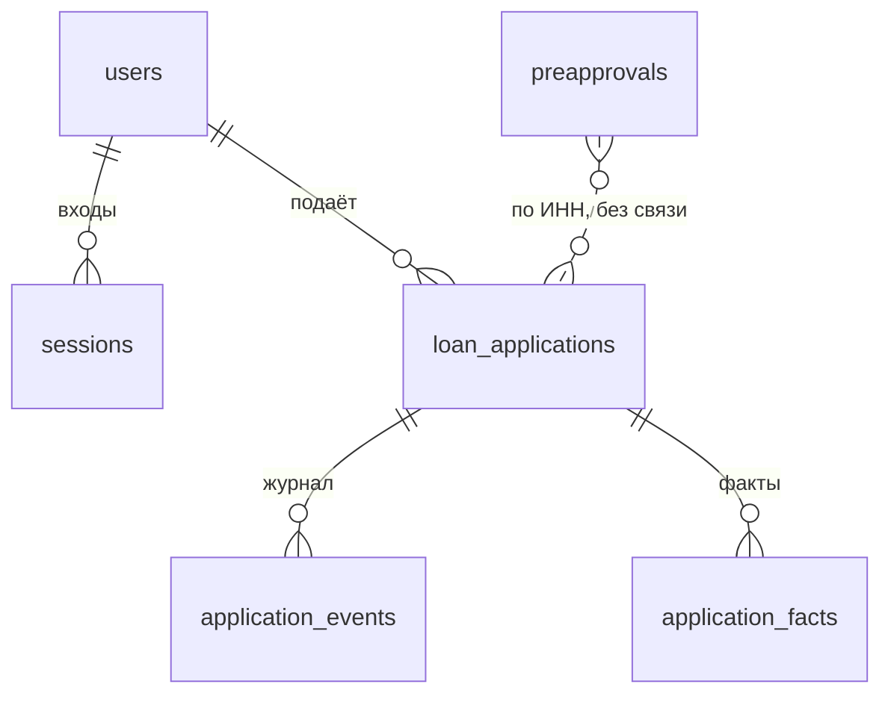

# Модель данных

Что конвейер хранит и как из сохранённого воспроизвести решение. Форматы обмена между модулями (Pydantic-модели и примеры JSON) — в [CONTRACTS.md](v2/CONTRACTS.md); здесь — таблицы базы данных и файлы, в которых эти форматы лежат.

База — PostgreSQL в Docker, SQLite (`data/alfa.db`) при локальном запуске; доступ через SQLAlchemy (`apps/api/db.py`), схема ведётся миграциями Alembic ([MIGRATIONS.md](../apps/api/MIGRATIONS.md)).

## Таблицы

| Таблица | Одна строка — это | Основные поля |
|---|---|---|
| `users` | Пользователь: клиент или сотрудник | `role` (`customer` / `staff`), `identity` — способ входа (`demo:<имя>` для демо-профиля, Telegram-идентичность), `staff_position` — `underwriter` / `risk_manager`, выбранная при входе сотрудника |
| `sessions` | Cookie-сессия | `token`, `user_id`, срок действия |
| `loan_applications` | Заявка | См. ниже |
| `application_events` | Событие журнала заявки, только добавление | `at`, `actor` (`system`, `client:<id>`, `staff:<id>`), `kind` (`status`, `source`, `action`, `decision`, `error`, `review`, `proposal`, `signature`), `from_status` / `to_status`, `message`, `data` |
| `application_facts` | Факт по заявке: одно значение из одного источника | `name`, `declared_value`, `verified_value`, `source`, `trust_level` (`bank` > `registry` > `client_document` > `declared`), `fetched_at`, `discrepancy`; уникален по паре «название — источник» |
| `preapprovals` | Последний результат предодобрения по ИНН | `approved`, `amount`, `computed_at`, `valid_until` (30 дней), `result` — расчёт целиком |

### `loan_applications`

Заявка хранит вход, результаты каждого этапа и служебные поля очереди. JSON-колонки содержат модели из `apps/api/contracts.py`.

| Поле | Что | Модель |
|---|---|---|
| `id`, `user_id`, `idempotency_key` | Заявка, её автор и ключ идемпотентности подачи (повтор с тем же ключом возвращает ту же заявку) | — |
| `status` | Статус ([PROCESS.md](PROCESS.md)) | `ApplicationStatus` |
| `revision` | Версия строки: устаревшая версия в запросе даёт 409 | — |
| `request` | Что просил клиент: ИНН, цель, сумма, срок, заявленная выручка, оборудование, согласия | `ApplicationRequest` |
| `enrichment` | Ответы источников с конвертом вызова (статус, время, попытки, ошибка); факты лежат отдельно в `application_facts` | `SourceResponse` по каждому источнику |
| `data_quality` | Показатели и уровень качества данных по счёту | `DataQuality` |
| `decision` | Последнее решение: статус, маршрут и причины, стоп-факторы, флаги, баллы, PD, грейд, вклады признаков, результат претендента, предложения с расчётом лимита и ставки, контрфактические подсказки, запрошенные документы, дата повторного обращения, версии | `Decision` |
| `statements` | Выписки, загруженные клиентом: распознанные обороты, имя файла, размер, SHA-256. `null` — клиент ещё не отвечал на запрос, `[]` — продолжил без выписки | `UploadedStatement` (`apps/api/statements.py`) |
| `offer_valid_until`, `selected_offer_id` | Срок предложений и выбранное предложение | — |
| `pending_review` | Предложение комитета, которое ждёт второй подписи | — |
| `closing` | Сформированные документы с текстом и временем подписи, хэш кода подписания и число попыток, подпись, отлагательные условия, выдача | — (`apps/api/disbursement.py`) |
| `attempts`, `lease_until` | Число запусков расчёта и аренда worker (или «не раньше» для повтора) | — |
| `created`, `updated` | Время создания и изменения | — |

Документы формируются один раз при выборе предложения и дальше не меняются; при подписи у каждого появляется время подписи. Файлы выписок не хранятся — только результат разбора и хэш.

## Файлы вне базы

| Что | Где | Кто пишет |
|---|---|---|
| Синтетический мир: компании, обороты, кредитные истории, исходы | `apps/world/out/` (не в git; в Docker — в образе) | `python -m apps.world` ([apps/world/README.md](../apps/world/README.md)) |
| Демо-персоны и их выписки из другого банка | `apps/world/demo/` | `python -m apps.world.personas` ([PERSONAS.md](../apps/world/PERSONAS.md)) |
| Обученная скоринговая карта, её паспорт и отчёт валидации | `apps/ml/scorecard_v1.json`, `scorecard_v1.training.json`, `scorecard_v1.validation.json` | `python -m apps.ml` ([apps/ml/README.md](../apps/ml/README.md)) |
| Экспертная карта-претендент | `apps/api/scorecards/scorecard_v0.json` | вручную |
| Кредитная политика: признаки, качество данных, лимит и ставка, исходы мира | `config/features.json`, `config/data_quality.json`, `config/credit_policy.json`, `config/world_outcomes.json` | экономический блок |

## Воспроизводимость решения

Решение — результат чистой функции `decide` (`apps/api/workflow.py`) от сохранённых данных, поэтому его можно пересчитать и получить тот же результат:

- **Вход:** `request`, `enrichment`, факты, `statements` — всё в базе.
- **Модель:** `Decision.model_version` — версия основной карты; версия набора признаков — в паспорте карты (`scorecard_vN.training.json`).
- **Политика:** `Decision.policy_version` = `credit=<версия>;data_quality=<версия>;features=<версия>` — версии трёх файлов `config/`.
- **Контракт:** `Decision.contract_version` — версия форматов (`CONTRACT_VERSION`).
- **Дата:** признаки считаются на дату среза синтетического мира (`WORLD_AS_OF`), срок предложений — от дня решения.

Журнал `application_events` показывает, кто и когда менял статус, что ответил каждый источник, какое решение принято и какие действия сотрудники совершили с кодом причины и комментарием.

## Что видит клиент и что — сотрудник

Клиент получает сокращённое решение (`client_decision`): клиентские тексты причин, предложения без ожидаемой прибыли, контрфактические подсказки, уровень данных с фразой для клиента, дату повторного обращения, статусы источников без текста ошибок. Флаги, баллы, PD, претендент и журнал с исполнителями клиенту не отдаются: среди флагов есть признаки ПОД/ФТ (SPEC §1.11). Сотрудник видит всё. Подробно — [WORKFLOW.md](../apps/api/WORKFLOW.md), раздел «API».
