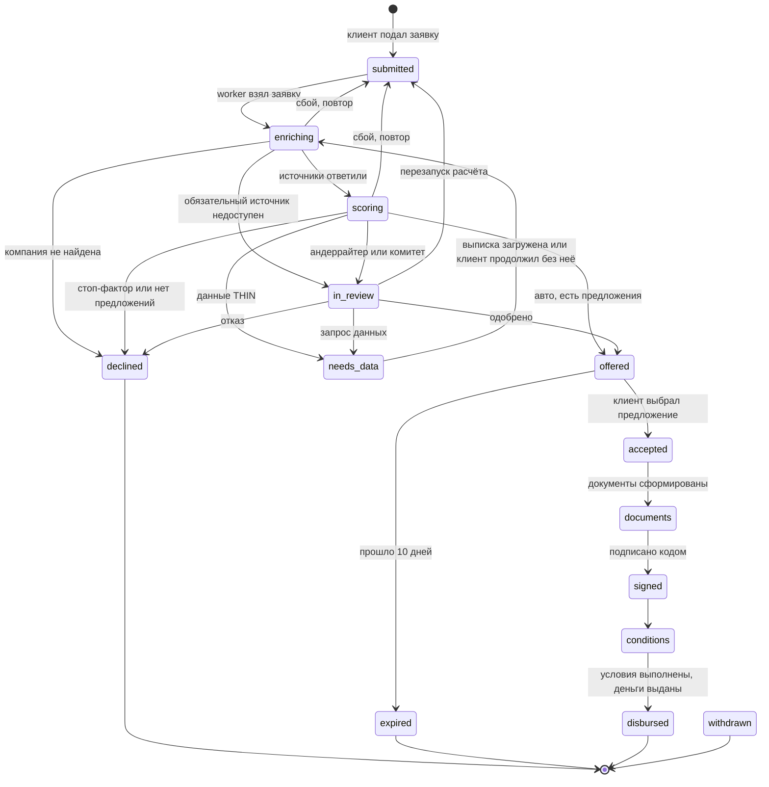

# Модель кредитного процесса

Как заявка проходит конвейер в прототипе: роли, этапы, статусы и почему каждый этап устроен именно так. Кредитная логика и её обоснование — в [SPEC](v2/SPEC.md); здесь описано то, что реализовано. Сроки этапов — в [SLA.md](SLA.md), моки и упрощения — в [SIMPLIFICATIONS.md](SIMPLIFICATIONS.md).

## Роли

| Роль | Кто это | Что делает | Где |
|---|---|---|---|
| Клиент | Предприниматель (ИП или ООО), уже клиент банка: регистрации нет | Выбирает компанию по ИНН, даёт согласия, описывает потребность, при необходимости загружает выписку, выбирает предложение, подписывает документы кодом | Веб-кабинет `/`, mini app `/mini/` |
| Система | Worker в том же процессе, что и API (в Docker — отдельный контейнер) | Обогащение, качество данных, стоп-факторы, скоринг, лимит и ставка, предложения, маршрут; отлагательные условия и выдача; ночное предодобрение | `apps/api/worker.py` |
| Андеррайтер | Сотрудник банка | Рассматривает заявки `in_review`: одобряет, меняет, отказывает, запрашивает данные, перезапускает расчёт. Код причины и комментарий обязательны | Рабочее место `/staff` |
| Риск-менеджер | Сотрудник банка | Вторая подпись по заявкам комитета; страница валидации модели и статистика переопределений | `/staff` |
| Кредитный комитет | Упрощённо: подписи андеррайтера и риск-менеджера, двух разных сотрудников (SPEC §15) | Решение по заявкам маршрута `committee` | `/staff` |

Бэк-офиса как отдельной роли нет: отлагательные условия проверяет и выдачу запускает система (SPEC §12 называет бэк-офис необязательным). Должность сотрудника выбирается при входе с общим паролем `STAFF_PASSWORD` (упрощение, [SIMPLIFICATIONS.md](SIMPLIFICATIONS.md)).

## Этапы

| № | Этап | Кто | Что происходит | Статус заявки | Код и описание |
|---|---|---|---|---|---|
| 0 | Предодобрение | Система, раз в сутки | Для клиентов с данными `FULL` без стоп-факторов и флагов считается овердрафт на авто-маршруте; на главной — «Вам доступно до X» | заявки ещё нет | `preapproval.py`, [PREAPPROVAL.md](../apps/api/PREAPPROVAL.md) |
| 1 | Компания и согласия | Клиент | ИНН → карточка из мок-ЕГРЮЛ/ЕГРИП → согласия на запрос в БКИ (218-ФЗ) по компании и собственнику и на обработку ПДн (152-ФЗ) | черновик в браузере | `company-onboarding.tsx`, [apps/web/README.md](../apps/web/README.md) |
| 2 | Потребность | Клиент | 3–6 вопросов: цель, сумма, срок, когда нужны деньги; для оборудования — цена, взнос, поставщик. Рекомендуется продукт | черновик в браузере → `submitted` | `need-intake.tsx` |
| 3 | Обогащение | Система | Восемь источников параллельно, тайм-аут и повторы по каждому; факты «заявлено / подтверждено»; уровень качества данных `FULL` / `PARTIAL` / `THIN` | `enriching` | `apps/sources/`, [apps/sources/README.md](../apps/sources/README.md), [features/README.md](../apps/api/features/README.md) |
| 3а | Запрос данных | Клиент | Только при `THIN` (и по запросу сотрудника): выписка из другого банка или «продолжить без неё» | `needs_data` → `enriching` | `statements.py`, [STATEMENTS.md](../apps/api/STATEMENTS.md) |
| 4 | Стоп-факторы и флаги | Система | Стоп-фактор — автоматический отказ без скоринга; флаг — повод для ручного рассмотрения | `scoring` | `stop_factors.py`, [STOP_FACTORS.md](../apps/api/STOP_FACTORS.md) |
| 5 | Скоринг | Система | Скоринговая карта → баллы, PD, грейд A–E, вклад каждого признака; модель-претендент в теневом режиме | `scoring` | `scoring.py`, [SCORING.md](../apps/api/SCORING.md), [apps/ml/README.md](../apps/ml/README.md) |
| 6 | Лимит, ставка, предложения | Система | Лимит — минимум из ограничений (денежный поток, долговая нагрузка, залог, оборот, продукт); ставка по составляющим; до трёх предложений и контрфактические подсказки | `scoring` | `limits.py`, `pricing.py`, `offers.py`, [LIMITS.md](../apps/api/LIMITS.md), [OFFERS.md](../apps/api/OFFERS.md) |
| 7 | Маршрутизация | Система | Матрица полномочий: автоматически / андеррайтер / комитет, с причинами | `offered`, `declined`, `in_review` | `routing.py`, [ROUTING.md](../apps/api/ROUTING.md) |
| 8 | Ручное рассмотрение | Андеррайтер, для комитета — и риск-менеджер | Одобрить предложения системы, изменить сумму и срок (не выше лимита), отказать, запросить данные, перезапустить расчёт | `in_review` → `offered`, `declined`, `needs_data`, `submitted` | `staff_actions.py`, [STAFF_ACTIONS.md](../apps/api/STAFF_ACTIONS.md) |
| 9 | Выбор предложения | Клиент | Одно из предложений; срок действия 10 дней | `offered` → `accepted` | `workflow.py`, [WORKFLOW.md](../apps/api/WORKFLOW.md) |
| 10 | Документы и подписание | Система + клиент | Кредитный договор, поручительство, залог, заявление на гарантию МСП — по условиям предложения; подписание одним кодом подтверждения (ПЭП) | `documents` → `signed` | `disbursement.py`, [DISBURSEMENT.md](../apps/api/DISBURSEMENT.md) |
| 11 | Отлагательные условия | Система (мок) | Поручительство подписано, залог внесён в реестр уведомлений, счёт поставщика проверен, гарантия МСП выдана | `conditions` | `disbursement.py` |
| 12 | Выдача | Система (мок) | Зачисление на счёт клиента или оплата поставщику (инвестиционный кредит) | `disbursed` | `disbursement.py` |

Решение принимает чистая функция `decide` (`workflow.py`): одинаковые входы дают одинаковое решение, а каждое решение хранит причины, версии модели и политик ([DATA_MODEL.md](DATA_MODEL.md)).

На странице заявки клиент может открыть ИИ-помощника и спросить о её статусе, причинах и предложениях. В контекст попадает только открытая заявка и только клиентское представление решения; без открытой заявки помощник отвечает в общем справочном режиме. Помощник не меняет данные и не влияет на расчёт. Модель необязательна: без неё или при ошибке провайдера остаётся серверный ответ по тому же контексту. Настройка и ограничения описаны в разделе [Языковая модель](../README.md#языковая-модель).

## Статусы

Таблица переходов — `TRANSITIONS` в `apps/api/workflow.py`. Статус меняет только `transition`: переход вне таблицы — ошибка, каждый переход пишет событие в журнал.

До подписания из любого статуса клиент может отозвать заявку (`→ withdrawn`); на схеме эти переходы не нарисованы, чтобы она читалась. Финальные статусы: `declined`, `expired`, `disbursed`, `withdrawn`.

| Статус | Смысл | Кто переводит дальше |
|---|---|---|
| `draft` | Черновик. Сервер его не создаёт: черновик живёт во вкладке браузера, заявка появляется сразу в `submitted` | — |
| `submitted` | Подана, ждёт worker | Система |
| `enriching` | Сбор данных из источников | Система |
| `needs_data` | Нужна выписка из другого банка | Клиент |
| `scoring` | Расчёт риска и условий | Система |
| `in_review` | У сотрудника | Андеррайтер, риск-менеджер |
| `offered` | Есть предложения | Клиент; система — по сроку |
| `declined` | Отказ | — |
| `accepted` | Предложение выбрано | Система |
| `documents` | Документы сформированы | Клиент |
| `signed` | Подписано | Система |
| `conditions` | Проверка отлагательных условий | Система |
| `disbursed` | Деньги выданы | — |
| `withdrawn` | Клиент отозвал | — |
| `expired` | Предложение истекло | — |

Отличия от схемы SPEC §13: переходы `enriching → declined` и `enriching → in_review` — ранний выход, когда компании нет или нет обязательного источника; `enriching | scoring → submitted` — повтор после сбоя расчёта (после третьей попытки заявка уходит в `in_review` без решения); `in_review → submitted` — перезапуск расчёта сотрудником.

## Почему этап есть, упрощён или отсутствует

| Этап или решение | Статус в прототипе | Почему |
|---|---|---|
| Анкета из 43 вопросов | Убрана | Клиент уже в банке: данные берутся из источников и счёта, а не со слов клиента (SPEC §1.1). Осталось 3–6 вопросов о потребности |
| Согласия 218-ФЗ и 152-ФЗ | Есть, упрощены | Без согласия запрос в БКИ незаконен. В демо согласие — галочка со временем, без подписи и реестра согласий |
| Обогащение с политикой отказа по источнику | Есть | Обязательный источник недоступен — заявку смотрит андеррайтер, необязательный — флаг. Конвейер не падает из-за одного источника (SPEC §5) |
| Уровень качества данных | Есть | Наличие счёта не гарантирует надёжные данные: от уровня зависят лимит, маршрут и предодобрение (SPEC §5.1) |
| Запрос документов | Только выписка при нехватке данных | Документы просят, когда данных мало, а не когда риск высок: высокий риск при полных данных ведёт к отказу или обеспечению (SPEC §1.7). Распознавания нет — выписка уже в JSON |
| Набор предложений вместо контрпредложения | Есть | Лимит не зависит от запрошенной суммы; клиент видит компромиссы (больше срок или меньше сумма) и что ограничило лимит (SPEC §10) |
| Ручное рассмотрение | Есть | Матрица полномочий: автоматически решаются только понятные случаи. Стоимость ручной обработки входит в ставку (SPEC §1.8) |
| Кредитный комитет | Упрощён до двух подписей | Заседание, протокол и квалифицированная ЭП вне скоупа хакатона |
| Подписание | Упрощено | Код показывается на экране вместо SMS; один код подписывает и поручительство |
| Отлагательные условия, выдача | Моки | Реестр залогов, Корпорация МСП и проводки — внешние системы, интеграции с ними запрещены условиями кейса |
| Предодобрение | Есть, только `FULL` | Быстрый путь для клиентов с надёжными данными по счёту; сама заявка всё равно решается заново |
| ИИ-ассистент | Опциональная надстройка | Решение принимает детерминированный движок; без модели сценарий работает так же |
| Сопровождение после выдачи | Нет | Вне скоупа кейса |
